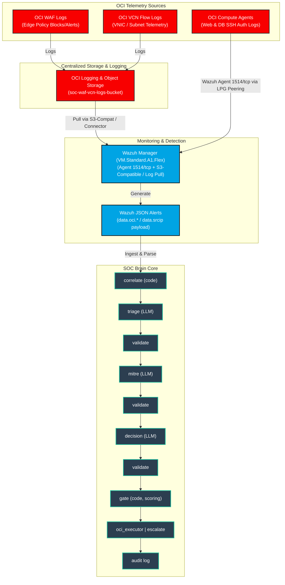

# Autonomous Multi-Agent SOC Brain Architecture (Oracle Cloud Infrastructure)

## Overview
This project implements an autonomous Security Operations Center (SOC) incident response pipeline on **Oracle Cloud Infrastructure (OCI)**. Security log telemetry from OCI infrastructure (OCI Web Application Firewall, OCI VCN Flow Logs, and host authentication logs from Compute instances) is ingested by the Wazuh Security Platform, normalized into standard Pydantic data models, and analyzed by an LLM-driven multi-agent framework governed by a deterministic Python state machine and OCI active-response executor.

> For a complete comparison between the previous AWS architecture and this Oracle Cloud Infrastructure architecture, see [docs/AWS_TO_OCI_MIGRATION.md](docs/AWS_TO_OCI_MIGRATION.md).

---

## Unified Data Ingestion & SOC Pipeline Architecture (OCI)

---

## Data Flow Details

1. **Telemetry Ingestion Phase:**
   - **Host Telemetry**: Wazuh agents on `soc-automation-web` and `soc-automation-db` in the Production VCN (`10.0.0.0/16`) forward real-time SSH and HTTP log events across the **Local Peering Gateway (LPG)** to the Wazuh Manager in the Security VCN (`172.16.0.0/16`).
   - **OCI Cloud Telemetry**: OCI WAF records HTTP inspection events (`clientIp`, `uri`, `ruleKey`) and OCI VCN Flow Logs record VNIC IP flows (`sourceAddress`, `destinationAddress`, `action`). Logs are exported to OCI Object Storage (`soc-waf-vcn-logs-*`).

2. **Wazuh Monitoring Phase:**
   - The Wazuh Manager (running on an OCI Always Free `VM.Standard.A1.Flex` instance with 4 OCPUs and 24 GB RAM) ingests both direct agent streams (`1514/tcp`) and OCI Object Storage log archives (via OCI's S3-compatible Customer Secret Key endpoint or OCI Logging integration).
   - Wazuh evaluates custom rules (`wazuh/rules/custom_oci_rules.xml` and `wazuh/rules/custom_ssh_rules.xml`) and emits unified JSON alerts to `/var/ossec/logs/alerts/alerts.json`.

3. **Normalization Phase:**
   - The SOC Brain (`ai_engine/ingest/wazuh_poller.py`) tails the Wazuh JSON alerts and normalizes both OCI cloud payloads (`data.oci.*` / `data.aws.*` S3-compat) and host authentication alerts into the strongly-typed `NormalizedEvent` Pydantic model.

4. **Multi-Agent Decision & Mitigation Phase (Deterministic State Machine):**
   - **Three agents in sequence**: `TriageAgent` -> `MitreAgent` -> `DecisionAgent` (backed by Ollama `llama3.2:3b` on `ollama-server` `172.16.1.20:11434`, with `num_ctx: 4096`, `<untrusted_log>` prompt-injection isolation, catalog-grounded MITRE mapping, and fuzzer URL query-string burst collapsing).
   - Each agent output is strictly validated against its Pydantic schema and deterministic evidence citation/MITRE catalog checks (`validator.py`) before the next stage runs.
   - **Deterministic Gate & Auth False-Positive Policy**: Evaluates weighted risk scores (`scoring.py`, `autonomous_threshold: 0.75`, `soft_threshold: 0.45`) and authentication behavioral features (`policy.py` R0–R5 backed by SQLite `BaselineStore` with cross-batch poisoning protection) before authorizing active response.
   - **OCI Active Response Executor (`ai_engine/executor/oci_executor.py`)**: Uses the `oci` Python SDK to perform idempotent, ETag-verified updates to OCI WAF Network Address Lists or simulated NSG quarantine, enforcing `SHADOW_MODE=true` by default, protected RFC 1918 CIDR checks, and pure-SSH WAF block refusals.
   - **Hybrid Docker & Observability (`Dockerfile`, `docker-compose.yml`, `docker-compose.demo.yml`)**: Containerizes `soc-poller` and `soc-dashboard` (port `8080`, Wazuh EUI theme with Tier-2 HITL case management) under non-root `socuser` (UID `1000`), mounting `/var/ossec/logs/alerts` as a read-only directory to survive daily Wazuh log rotation.
